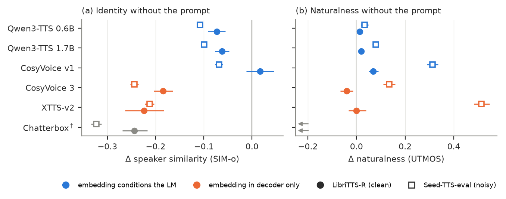

# Speaker identity is split across conditioning sites

Code, experiment design, per-utterance scores and paper sources for
*Speaker Identity Is Split Across Conditioning Sites: Prompt and Embedding
Pathways in Zero-Shot Voice Cloning* (Callum Macpherson, 2026; preprint
forthcoming). Audio samples: <https://callumjmac.github.io/conditioning-sites/>.

Most zero-shot TTS systems condition on the target speaker twice: through an
in-context acoustic prompt, and through a speaker embedding that some systems
feed to the language model (LM) and others only to the acoustic decoder. We
remove the prompt, keep the embedding, and measure what is left.



- Across six open-weight systems and two test sets (25,509 utterances), speaker
  similarity to a held-out recording (SIM-o) changes by +0.02 to -0.11 when the
  embedding also conditions the LM (Qwen3-TTS, CosyVoice-300M) and drops by
  0.18 to 0.24 when it only reaches the decoder (CosyVoice 3, XTTS-v2).
- In CosyVoice-300M, which feeds one embedding to both stages, a 2 x 2 x 2
  factorial over prompt, LM embedding and decoder embedding (6,480 utterances)
  shows that the two sites add up: without the prompt, removing the LM
  embedding costs 0.113 SIM-o and removing the decoder embedding 0.201
  (LibriTTS-R). With the prompt, the LM embedding no longer matters (-0.010,
  n.s.) and the decoder embedding still does (-0.070).
- Prompts carry their recording conditions into the output. Removing them
  raises UTMOS by up to 0.51 on Seed-TTS-eval, but UTMOS also rises when all
  speaker information is removed, so that gain is not a cloning improvement.
- Three references instead of one add 0.02 to 0.04 SIM-o in either route, with
  no change in naturalness; F5-TTS, which has no embedding route, gets worse.

## Reproduce the paper's numbers

The per-utterance scores are in this repository, so every table and figure can
be rebuilt without a GPU in about two minutes:

```bash
git clone https://github.com/CallumJMac/conditioning-sites.git && cd conditioning-sites
uv venv && uv pip install -e ".[dev]"        # or: python -m venv .venv && pip install -e ".[dev]"
make check PYTHON=.venv/bin/python           # recompute analysis and tables, fail on any change
make paper PYTHON=.venv/bin/python           # paper/main.pdf (needs a LaTeX install)
```

`make check` recomputes `results/analysis/*.csv` from
`results/scores/pathway_scores.csv`, regenerates `paper/tables/` and
`paper/figures/`, and runs `git diff --exit-code` on them. It is run on every
push (`.github/workflows/check.yml`).

| Paper item | Source data | Produced by |
|---|---|---|
| Fig. 1, Tables 4-5 (pathway contrasts) | `results/scores/pathway_scores.csv`, `jobs/pathway.jsonl` | `condsites.analysis`, `condsites.figure_pathway`, `condsites.report` |
| Fig. 2, Tables 2 and 7 (site factorial) | `results/scores/factorial_scores.csv`, `jobs/factorial.jsonl` | `condsites.report` |
| Tables 3 and 6 (reference count) | `results/analysis/refcount_effects.csv` | `condsites.analysis`, `condsites.report` |
| Table 8 (synthesis failures) | `results/scores/pathway_status.jsonl` | `condsites.report` |

## Repository layout

```
src/condsites/        package: backends, synthesis runner, scoring, analysis, report
  backends/           one wrapper per TTS system; each implements full and x-vector-only conditioning
  systems.py          system list with pinned Hugging Face and source revisions
jobs/                 experiment design: one JSON line per utterance (system, condition, references, target, seed)
results/scores/       per-utterance scores (SIM-o, SIM-p, WER, UTMOS) and synthesis status
results/analysis/     speaker-level contrasts with bootstrap CIs and Holm-adjusted p-values
paper/                TMLR-format paper source (make paper); paper/short/ is the 4-page version
listening_study/      browser-based paired comparison (CMOS/CSMOS) study for Prolific
scripts/              data download, environment setup, scoring models, sample builder
data/                 LibriTTS-R manifest and checksums (audio is downloaded, not committed)
docs/                 GitHub Pages demo with curated samples
tests/                unit tests for the conditioning interventions (pytest)
```

## Systems

| System | Hugging Face repo @ revision | Embedding enters | Licence |
|---|---|---|---|
| Qwen3-TTS 0.6B | `Qwen/Qwen3-TTS-12Hz-0.6B-Base` @ `5d83992436` | LM input | Apache-2.0 |
| Qwen3-TTS 1.7B | `Qwen/Qwen3-TTS-12Hz-1.7B-Base` @ `fd4b254389` | LM input | Apache-2.0 |
| CosyVoice-300M | `FunAudioLLM/CosyVoice-300M` @ `24c40509c3` | LM and flow decoder | Apache-2.0 |
| CosyVoice 3 | `FunAudioLLM/Fun-CosyVoice3-0.5B-2512` @ `29e01c4e8d` | flow decoder only | Apache-2.0 |
| XTTS-v2 | `coqui/XTTS-v2` @ `6c2b0d75ea` | vocoder decoder only | CPML-1.0, non-commercial |
| Chatterbox | `ResembleAI/chatterbox` @ `5bb1f6ee58` | LM (T3) | MIT |
| F5-TTS v1 | `SWivid/F5-TTS` @ `84e5a410d9` | none (prompt only) | CC-BY-NC-4.0 |

Full commit hashes, and the source-checkout commits for CosyVoice, XTTS-v2 and
Chatterbox, are in `src/condsites/systems.py`. Where the embedding enters was
read from each system's inference code; the x-vector-only intervention for each
is described in `src/condsites/backends/` and in Section 3.1 of the paper.

## Data

```bash
python scripts/fetch_data.py
```

downloads the 1,731 LibriTTS-R `test-clean` utterances listed in
`data/libritts_r_aligned/manifest_40spk.json` (from the `mythicinfinity/libritts_r`
parquet export) and the Seed-TTS-eval test set, and checks every file against
`data/libritts_r_aligned/SHA256SUMS` or the archive checksum. The WAVs it writes
are byte-identical to the ones used in the paper.

## Re-scoring audio

Scoring follows the Seed-TTS-eval protocol: SIM with the WavLM-large
speaker-verification checkpoint, WER with Whisper-large-v3 after
lowercasing and removing punctuation, and UTMOS (`utmos22_strong`).

```bash
bash scripts/fetch_scoring_models.sh          # pinned seed-tts-eval commit + checksum-verified checkpoint
python -m condsites.scoring --manifest <manifest.csv> --output scores.csv \
  --unispeech-dir .external/eval/seed-tts-eval/thirdparty/UniSpeech/downstreams/speaker_verification \
  --sv-checkpoint .external/eval/wavlm_large_finetune.pth --device cuda --skip-utmosv2
```

A manifest row is `clip_id,wav,text,prompt_wav,heldout_wav`. Scoring runs at
about 70 utterances per minute per process on an A10G.

## Regenerating audio

Each system needs its own virtualenv because their dependencies conflict. The
Dockerfile reproduces the environment the paper's audio was made in
(`pytorch/pytorch:2.5.1-cuda12.4-cudnn9-runtime`, CUDA 12.4, uv-managed Python
3.10 and 3.11):

```bash
docker build -t condsites .
docker run --gpus all --shm-size 8g -v "$PWD":/work -w /work condsites bash scripts/setup_all.sh
docker run --gpus all --shm-size 8g -v "$PWD":/work -w /work condsites \
  .venv-qwen/bin/python -m condsites.synthesize --jobs jobs/pathway.jsonl --system qwen17 \
  --shard 0 --num-shards 1 --output-dir audio
```

`--shard` and `--num-shards` split a system's jobs across processes; existing
WAVs are skipped, so runs can be resumed. The pathway study took about 25
A10G-hours (three GPUs, two processes each) and the factorial about 5.5.

## Listening study

`listening_study/` is a static web app (paired CMOS for naturalness, CSMOS for
speaker match, Huggins-pitch headphone screen, trap trials) with a
pre-registered analysis script. See `listening_study/DEPLOY.md` to run it
locally or on Prolific. Results are not yet collected; the paper reports
automatic metrics only.

## Known issues and history

- An earlier version of the Qwen3-TTS backend L2-normalised the x-vector before
  synthesis. Qwen's embedding has a norm of about 10, and normalising it cut
  x-vector-only SIM from 0.88 to 0.71. This produced a spurious reversal in an
  earlier run; the backend now passes the raw mean (test:
  `tests/test_backends.py::test_qwen_average_embeddings_preserves_magnitude`).
- The first held-out recordings for LibriTTS-R SIM-o were short enrolment
  clips, 12 of 34 under 3 s. All results here use the longest recording over
  9.5 s that is never a prompt or target (`jobs/heldout_map.json`).
- Earlier runs built prompts at 16 kHz; all runs here use 24 kHz.
- UTMOSv2 takes about 25 s per utterance in its single-file mode, so it was
  dropped from the main runs; it agrees in direction with UTMOS on the earlier
  LibriTTS-R audio.
- 25 of 3,196 Chatterbox utterances failed to synthesise (logged in
  `results/scores/pathway_status.jsonl`); no other system failed.
  Of the 25,509 synthesised pathway utterances, 9 could not be scored and are
  marked `SCORING_ERROR` in `results/scores/pathway_scores.csv`: five runaway
  outputs exhausted GPU memory and four were too short for UTMOS.

## Responsible use

The repository analyses existing open models and adds no new cloning
capability. All voices come from public, consented corpora (LibriVox readers via
LibriTTS-R; Common Voice contributors). Because identity survives from the
speaker embedding alone in several systems, speaker embeddings should be
handled as identity-bearing data. See `ETHICS_AND_LICENSES.md`.

## Licence

Code: MIT (`LICENSE`). Generated audio carries the licence of the model that
produced it (`LICENSE_audio.md`): XTTS-v2 output is CPML-1.0 and F5-TTS output
CC-BY-NC-4.0, both non-commercial. Model weights, the WavLM-large checkpoint and
the Seed-TTS-eval test set are not redistributed.

## Citation

```bibtex
@misc{macpherson2026conditioning,
  title  = {Speaker Identity Is Split Across Conditioning Sites: Prompt and Embedding Pathways in Zero-Shot Voice Cloning},
  author = {Macpherson, Callum},
  year   = {2026},
  note   = {Preprint}
}
```

`CITATION.cff` has the same entry for GitHub's "Cite this repository" button.
